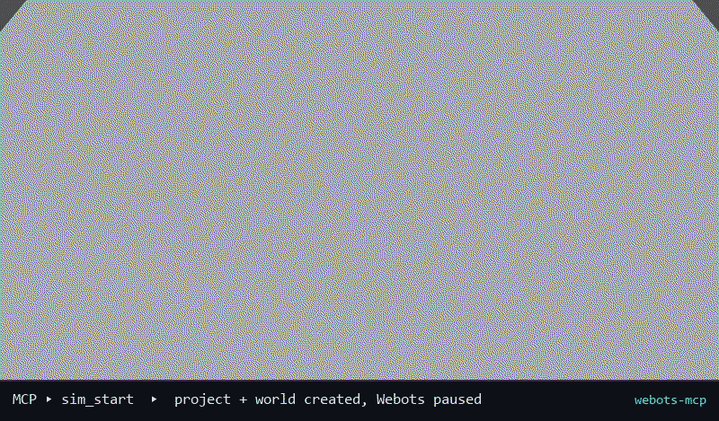

# Webots MCP

**让任意 MCP agent 直接驱动一个真实的 Webots 仿真。**

[English](README.md) | 简体中文

[](LICENSE)

Webots MCP 是一个本地 [Model Context Protocol](https://modelcontextprotocol.io) 服务器：agent 通过普通的 MCP 工具调用，就能完成「建项目 → 搭场景 → 跑实验 → 读结果 → 修正」的闭环，包括启动/暂停/单步 Webots、修改运行中的场景、做物理观测和截图。



*上面的 GIF 是真实 Webots 会话：通过 MCP 主进程依次执行 `project_create` → `sim_start` → 暂停状态下搭场景 → 物理仿真。不是动画模拟。*

## 为什么需要它

Webots 是桌面应用，有自己的进程生命周期、仿真时钟和 Python 控制器 API。agent 不能只靠执行一段脚本就「跑仿真」：它需要一个长期驻留在 Webots 内的控制器、可精确控制的暂停/单步，以及查询当前场景的手段。

本项目把这些能力收在一个 MCP 端点后面：

- **Rust 主进程**负责 Webots 的启停、仿真时钟和 MCP 会话；
- **Python Supervisor 控制器**运行在 Webots 内，提供场景、物理、查询和实验工具；
- 独立的 **project_manager** 进程负责项目和世界文件，Webots 没启动也能用。

agent 看到的是一份动态汇总的扁平工具列表，不需要关心端口、控制器进程或 Webots 窗口。

## 架构

```text
MCP 客户端（Claude Desktop、IDE agent、自写客户端……）
        │  MCP over stdio
        ▼
webots-mcp-host (Rust)
        │  启动 / 停止 Webots，控制暂停 / 单步 / 重置
        │
        ├── TCP 127.0.0.1:<port>，NDJSON ──▶ Supervisor 控制器（Python，Webots 内）
        │                                     场景 / 物理 / 查询 / 实验工具
        │
        └── stdin/stdout ───────────────────▶ project_manager.py（独立进程）
                                              项目 / 世界 / supervisor 绑定
```

- **主进程是唯一的 MCP 服务器。** 它把自己的 8 个时钟工具，与 Supervisor、project_manager 上报的工具合并后暴露。
- **工具动态发现。** 两个 Python 进程连上后发送带完整清单的 `hello`；主进程缓存清单、广播 `notifications/tools/list_changed`，因此 Webots 启动前也能看到上次会话缓存的工具。
- **暂停时 Supervisor 不会阻塞。** 暂停状态下调用 `step(0)`，所以场景编辑、查询、截图照常工作，但仿真时间不前进。
- **project_manager 可选但推荐。** 它提供 `project_*`、`world_*`、`supervisor_bind`，且不依赖 Webots。

## 功能

- **一键建项目**：目录、`project.json`、带光照/背景/地面的 ENU 世界、Supervisor 机器人一次生成。
- **暂停状态下搭场景**：基础几何体、原始 VRML 节点、灯光、背景、视角；改场景不推进时间。
- **可控时钟**：暂停、实时/快速继续、精确前进 N 个基础时间步，以及物理 / 仿真 / 世界 / 进程四级重置。
- **物理实验**：按时间采样节点位姿，可在物体静止或掉出世界时提前结束，一次返回位移、路径长度、最大速度、静止用时等统计。
- **给 agent 的排错工具**：场景树、节点完整字段、接触点、静态场景校验，以及把每个 `Solid` 分类为动态 / 静态碰撞体 / 无碰撞的物理健康检查。
- **状态快照**：保存和恢复节点位姿，方便换参数重复实验。
- **截图与保存世界**：截取真实的 Webots 3D 视口，或把当前世界写回磁盘。
- **运行时不依赖第三方 Python 包**：工具注册表只用标准库，并从类型注解生成 JSON Schema。

完整连接后共有 **55 个工具**：8 个主进程时钟工具、10 个项目/世界工具、37 个 Supervisor 工具。

## 环境要求

| 组件 | 要求 |
|---|---|
| Webots | R2025a 及以上；已在 Windows 的 **R2025b** 上实测 |
| Rust | 较新的 stable 工具链（edition 2021） |
| Python | **3.10+**（Supervisor 使用现代类型语法） |
| 操作系统 | 目前在 **Windows 10/11** 上开发和测试；Linux/macOS 尚未验证 |
| 构建工具 | `cargo`，无需额外系统库 |

Webots 必须能创建 OpenGL 窗口。截图和 demo 生成需要可用的 GPU/OpenGL 上下文，纯 headless shell 或部分远程桌面会话不满足条件。

## 快速开始

### 1. 克隆并构建主进程

```bash
git clone https://github.com/colin-live/mcp_webots.git
cd mcp_webots/host
cargo build --release
```

产物是 `host/target/release/webots-mcp-host`（Windows 下为 `.exe`）。

### 2. 配置 MCP 客户端

把主进程注册成 stdio MCP 服务器。通用客户端示例：

```json
{
  "mcpServers": {
    "webots": {
      "command": "D:/tools/mcp_webots/host/target/release/webots-mcp-host.exe",
      "env": {
        "WEBOTS_HOME": "C:/Program Files/Webots",
        "WEBOTS_MCP_SUPERVISOR_DIR": "D:/tools/mcp_webots/supervisor",
        "WEBOTS_PROJECTS_DIR": "D:/webots_projects",
        "WEBOTS_MCP_PYTHON": "python"
      }
    }
  }
}
```

请使用绝对路径；Windows 下用正斜杠可以避免 JSON 转义。

| 环境变量 | 作用 |
|---|---|
| `WEBOTS_HOME` | Webots 安装目录。省略时主进程会探测常见安装位置和 `PATH`。 |
| `WEBOTS_MCP_SUPERVISOR_DIR` | 指向本仓库的 `supervisor/` 目录。**启用 project_manager**，同时作为共享控制器源码位置。 |
| `WEBOTS_PROJECTS_DIR` | `project_create` 写入项目的根目录。默认值由 supervisor 路径推断，建议显式设置。 |
| `WEBOTS_MCP_PYTHON` | 运行 `project_manager.py` 的 Python。Windows 默认 `python`，其他平台默认 `python3`。 |
| `WEBOTS_MCP_WORLD` | `sim_start` 未传 `world` 时使用的默认 `.wbt` 世界。 |
| `WEBOTS_BIN` | 直接指定 Webots 可执行文件，优先于 `WEBOTS_HOME` 探测。 |
| `WEBOTS_MCP_STATE_DIR` | Supervisor 工具清单缓存目录，默认在用户缓存目录下。 |
| `WEBOTS_MCP_SAVE_DIR` | Supervisor 保存截图和世界的目录。项目内控制器默认指向 `<项目>/data`。 |
| `WEBOTS_MCP_LOG` | 主进程日志级别，例如 `debug`。日志走 stderr，stdout 只放 MCP 消息。 |
| `WEBOTS_MCP_TOKEN` | 可选的 IPC 共享密钥，Supervisor 的 `hello` 必须携带。 |
| `WEBOTS_MCP_AUTO_RESUME` | 设为 `0` 时，`run_simulation` 不会自动恢复暂停的世界。 |

### 3. 开始使用

建议让 agent 先调用 `get_workflow_guide`，它会返回工具分类和推荐的「建模 → 实验 → 分析 → 修正」流程。

示例提示词：

> 创建一个叫 `drop_test` 的 Webots 项目，搭一个六层方块堆，上方放一个球，运行三秒，截图，并告诉我方块堆有没有倒。

手动调用时的典型顺序：

```text
project_create(project_name="drop_test")
sim_start(world="<project_create 返回的 world_path>")
create_primitive(def_name="BALL", primitive_type="Sphere", size=[0.2], mass=2.0,
                 translation=[0.2, 0.0, 2.5], color=[1.0, 0.8, 0.2])
set_viewpoint(...)                       # 截图前先取景
save_snapshot(name="start")              # 可选：保存可重复的初始位姿
run_simulation(duration=2.0, target_defs=["BALL"])
capture_screenshot(filename="drop_test.png")
sim_stop()
```

`sim_start` 默认以**暂停**模式启动，所以所有搭建动作都发生在 `t = 0`。`run_simulation` 需要时会自动恢复，观测结束后再暂停。

## 工具一览

工具名和 JSON Schema 构成对外接口。工具描述目前是中文；名称、参数和返回的 JSON 字段与语言无关。

### 主进程 / 仿真时钟（8）

| 工具 | 作用 |
|---|---|
| `sim_start` | 启动 Webots 并加载世界。默认暂停，便于先搭场景；等待 Supervisor 连接。 |
| `sim_stop` | 先让 Supervisor 正常退出，再停止 Webots（或强制结束进程树）。 |
| `sim_restart` | 停止并重新启动 Webots，回到干净的初始状态。 |
| `sim_pause` | 暂停仿真。暂停期间场景和查询工具仍可用。 |
| `sim_resume` | 以 `real_time` 或 `fast` 模式继续运行。 |
| `sim_step` | 从暂停状态精确前进 `count` 个基础时间步，然后再次暂停。 |
| `sim_reset` | 四级重置：`physics`、`simulation`、`reload`、`restart`。 |
| `sim_status` | 查看进程、Supervisor 连接、时钟状态、模式和仿真时间。 |

`sim_reset` 的四种模式：

| 模式 | 效果 |
|---|---|
| `physics` | 只清零物理状态，时间和场景不变。 |
| `simulation` | 时间归零并恢复已保存的世界；运行时创建的节点会被删除，需要保留就先 `save_world`。 |
| `reload` | 重载世界并重启 Supervisor，快照和观测任务丢失。 |
| `restart` | 结束并重新启动 Webots。 |

### 项目与世界文件（10）

由 `project_manager.py` 提供，Webots 未启动时也可用。

| 工具 | 作用 |
|---|---|
| `project_list` | 列出项目根目录下的项目。 |
| `project_create` | 一步创建可运行项目：目录、manifest、ENU 世界、地面、光照、Supervisor 机器人和控制器，返回 `world_path`。 |
| `project_info` | 查看世界、PROTO、控制器、Supervisor 绑定、manifest 和目录树。 |
| `project_check` | 静态检查世界头、`EXTERNPROTO`、控制器目录和 Supervisor 绑定。 |
| `project_delete` | 删除项目，必须重复项目名确认。 |
| `project_read_file` | 读取项目内 UTF-8 文本文件，带路径越界保护。 |
| `project_write_file` | 写入项目内文本文件，自动创建父目录。 |
| `world_add_robot` | 向 `.wbt` 插入机器人、补 `EXTERNPROTO`，可同时写控制器源码。 |
| `world_remove_node` | 按 DEF 删除世界文件里的根级节点。 |
| `supervisor_bind` | 给已有项目/世界绑定 Supervisor 机器人和控制器。 |

`project_create` 默认以 **link** 模式安装控制器：项目里只有一个几行的启动器，真正代码始终是本仓库的 `supervisor/`，改一次所有项目生效。需要项目自包含时用 `mode="copy"`。

世界文件工具改的是磁盘上的 `.wbt`，运行中的仿真想看到变化，需要 `sim_restart` 或 `sim_reset(kind="reload")`。

### 场景、物理、查询与实验（37）

这些工具由运行在 Webots 内的 Supervisor 执行。

| 分组 | 工具 |
|---|---|
| 构建 | `create_primitive`, `create_component`, `create_components`, `add_light`, `set_world_appearance`, `set_viewpoint`, `delete_node`, `clear_created_nodes` |
| 修改 | `set_node_field`, `set_node_pose`, `import_into_field`, `set_world_physics`, `set_contact_properties` |
| 物理 | `set_node_velocity`, `apply_force`, `apply_torque`, `reset_node_physics` |
| 查询 | `get_scene_tree`, `get_node_details`, `get_node_state`, `get_nodes_by_type`, `get_contact_points`, `check_physics_health`, `validate_scene` |
| 实验 | `get_simulation_info`, `start_simulation`, `run_simulation`, `get_simulation_status`, `get_simulation_result`, `list_simulations`, `reset_simulation` |
| 快照 | `save_snapshot`, `restore_snapshot`, `list_snapshots` |
| 输出 | `capture_screenshot`, `save_world` |
| 指南 | `get_workflow_guide` |

几个要点：

- `create_primitive` 支持 `Box`、`Sphere`、`Cylinder`、`Capsule`。`mass=0` 是静态碰撞体（地面/墙）；`mass>0` 是受重力的动态物体。
- `run_simulation` 一次完成「启动观测 → 等待 → 返回 summary + 抽样轨迹」。可设 `stop_when_settled=true` 提前结束；长实验用 `start_simulation` + 状态/结果轮询。
- `check_physics_health` 会区分正确的静态体、动态体，以及缺少碰撞几何的物体，是排查「穿地」最快的方法。
- `capture_screenshot` 写入 `<save dir>/screenshots/`（默认 JPEG），内容取决于当前 `Viewpoint`，先 `set_viewpoint` 取景。PNG 会被无损重新压缩（Webots 导出的 PNG 几乎不压缩，1955×1344 约 7.9 MB）；`scale`（需要 Pillow）可缩小尺寸。暂停时 Webots 不重绘：如果场景或视角变了但图像与上一张字节相同，结果会带 `stale: true`，此时先 `sim_resume(real_time)` 再截图，或传 `render_steps=1`（仿真时间会前进）。
- 快照只保存节点位姿，不保存速度、接触状态或世界文件。

## 目录

```text
host/                     Rust MCP 主进程
  src/mcp.rs              MCP stdio 会话与动态工具列表
  src/sim.rs              Webots 进程与时钟工具（sim_*）
  src/pm.rs               project_manager 子进程
  src/ipc.rs              与 Supervisor 的 NDJSON IPC
supervisor/               Webots 内执行的 Python 代码
  mcp_server.py           Supervisor 控制器入口
  project_manager.py      项目/世界工具（独立进程）
  webots_mcp/             时钟、IPC 客户端、场景辅助、工具模块
tests/                    端到端测试与假 Webots
docs/                     demo 生成脚本和媒体
```

## 测试

端到端测试用假 Webots 跑**真实**的 Supervisor 代码，不需要安装 Webots：

```bash
cd host
cargo build --release
cd ..
python tests/e2e.py --release
```

覆盖：工具动态暴露、暂停时场景工具可用、精确单步、暂停/继续、reset / reload / restart、优雅停止、project_manager 崩溃后重启、主进程随 stdin 关闭退出。

可选的真实 Webots 测试（会弹窗）：

```bash
python tests/real_smoke.py  --webots-home "C:\Program Files\Webots"
python tests/real_project.py --webots-home "C:\Program Files\Webots"
```

`real_smoke.py` 走一遍典型搭建与运行流程；`real_project.py` 验证生成的项目、`EXTERNPROTO`、link 控制器和 Supervisor 绑定能在真实 Webots 中加载，并经历一次世界重载。

## 重新生成 demo GIF

demo 是通过 MCP 主进程驱动真实 Webots 生成的，不是录屏：

```bash
pip install pillow
python docs/make_demo.py --webots-home "C:\Program Files\Webots"
```

脚本会创建临时项目、启动 Webots、搭场景、推进仿真，用 `capture_screenshot` 抓帧并合成 `docs/media/demo.gif`。加 `--keep-frames` 可保留原始帧。

## 真实 Webots 实测说明

在 R2025b（Windows）上确认过的行为：

- Supervisor 约 4 秒连上主进程；暂停状态下 `step(0)` 让场景/查询/构建工具照常工作。
- `sim_step 10` 恰好前进 10 个基础步；实时运行、暂停、reset、正常退出都正常。
- 暂停状态下建场景 → 物理正常 → `run_simulation` 自动恢复并在任务完成那一步暂停 → `sim_reset(kind="simulation")` 清除运行时创建的节点。

实现上需要注意：

1. **启动模式**：`--mode=pause` 启动时 Webots 不会启动控制器，所以主进程先用 `--mode=realtime` 启动；Supervisor 连上后立即自己暂停，主进程再 reset 一次，让会话从 `t≈0` 开始。
2. **进程名**：`webots.exe` / `webotsw.exe` 只是启动器，真正的进程是 `webots-bin.exe`。启动器会一直等它，所以进程监控正常；强制停止时主进程用 `taskkill /T` 结束整棵进程树。
3. **Windows 安装路径**：依赖库在 `msys64\ucrt64\bin`（不是 `mingw64`），已加入自动探测。
4. 日志里重复出现的 `Unsupported file type '/api/v1/models'` 是 Webots 自身的警告，与本项目无关。

## 常见问题

| 现象 | 原因 / 处理 |
|---|---|
| `Webots could not initialize the rendering system` 或 `Failed to load opengl32sw` | Webots 无法创建 OpenGL 上下文。请在正常桌面会话中运行并安装显卡驱动；远程桌面、headless 和缺少驱动是常见原因。 |
| `tools/list` 里没有项目工具 | 没有设置 `WEBOTS_MCP_SUPERVISOR_DIR`，或它没有指向 `supervisor/` 目录。 |
| `sim_start` 等待 Supervisor 超时 | 世界里没有 `controller "mcp_server"` 且 `supervisor TRUE` 的机器人，或控制器连不上主进程。检查 Webots 控制台和主进程 stderr（`WEBOTS_MCP_LOG=debug`）。 |
| `sim_step` 前进的步数超过请求 | 还有其他非同步控制器在推进仿真。只保留一个同步 Supervisor，并让机器人使用 `synchronization TRUE`。 |
| 新加的世界节点不生效 | 世界文件工具改的是磁盘文件，需要 `sim_restart` 或 `sim_reset(kind="reload")`。 |
| reset 后运行时创建的对象消失 | `sim_reset(kind="simulation")` 会恢复已保存的世界；需要保留就先 `save_world`。 |
| 主进程被强杀后 Webots 还在 | Windows 正常退出会结束进程树，但被硬杀的宿主无法清理子进程，请手动关闭 Webots。 |

## 限制

- 目前只在 Windows 上验证。代码按可移植方式编写，但 Linux/macOS 的路径探测和进程树结束尚未实测。
- 工具覆盖常见的场景搭建、刚体物理和观测流程，不是完整 Webots API（不含摄像头图像流、激光雷达处理、电机控制环和自定义物理插件）。
- `sim_step` 的精确步数依赖 Supervisor 是唯一推进世界的控制器。
- 工具描述目前为中文；MCP 工具名、参数 Schema 和返回 JSON 字段稳定且与语言无关。
- 截图需要可见的 3D 视口；`fast` 模式不保证每帧都渲染。

## 参与贡献

欢迎 issue 和 pull request。

- 新的 Supervisor 工具写在 `supervisor/webots_mcp/tools/`，用 `@tool` 注册，Schema 由类型注解生成。
- 需要控制 Webots 进程或时钟的工具属于 Rust 主进程（`host/src/sim.rs`），不要放进 Supervisor。
- 提交前运行 `python tests/e2e.py --release`。
- 新增或修改用户文档时，请同步更新 `README.md`。

## 许可证

[Apache License 2.0](LICENSE)
